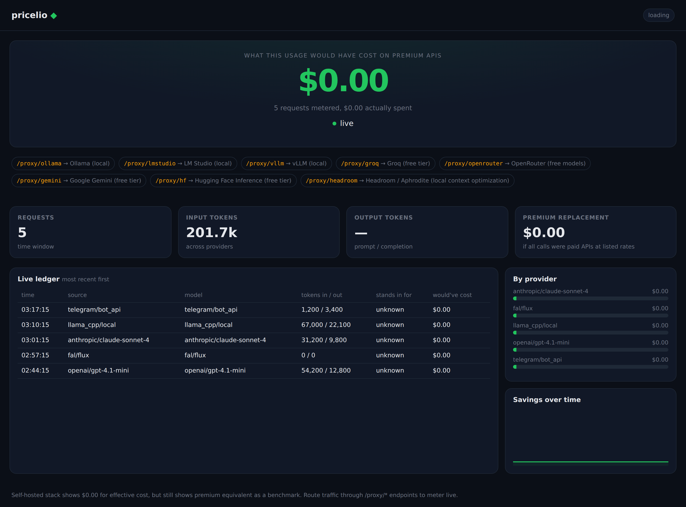

<div align="center">


# pricelio

*Formerly CostForge — self-hosted API cost estimation and metering dashboard.*

Cloud cost analysis and optimization dashboard — track spending, identify waste, and optimize cloud bills across providers.

[](https://github.com/OneByJorah/pricelio/releases)
[](https://www.docker.com/)
[](https://www.python.org/downloads/)
[](https://opensource.org/licenses/MIT)

</div>



## What This Is

pricelio is a self-hosted cost observability layer for API and LLM usage. Run it as a transparent HTTP reverse proxy or push usage events to the `/ingest` endpoint. The dashboard shows what the same usage would have cost on premium APIs, making it easy to measure savings from local models, free tiers, and self-hosted stacks.

Built for operators who want a Docker-deployed dashboard they control.

## Quick Start

```bash
git clone https://github.com/OneByJorah/pricelio.git
cd pricelio
cp .env.example .env
docker compose up -d --build
```

Open the dashboard at `http://127.0.0.1:8090` and verify health:

```bash
curl http://127.0.0.1:8000/healthz
```

## Install

### Docker (recommended)

```bash
git clone https://github.com/OneByJorah/pricelio.git
cd pricelio
docker compose up -d --build
```

The compose stack binds the backend to `127.0.0.1:8000` and the frontend to `127.0.0.1:8090`.

### From Source

```bash
git clone https://github.com/OneByJorah/pricelio.git
cd pricelio
cd backend
python -m venv .venv
source .venv/bin/activate
pip install -r requirements.txt
python main.py
```

The source path is useful for local development; Docker is recommended for production.

## Features

- **Self-hosted** — no cloud dependencies, run on your own hardware
- **Docker Compose** — full stack deployment with one command
- **Transparent proxy metering** — route traffic through `/proxy/{provider}/*` and meter automatically
- **Event ingestion** — push usage from Hermes, GitHub, Telegram, or any adapter via `/ingest`
- **Premium-equivalent costs** — see what usage would cost on paid APIs as a savings benchmark
- **Live dashboard** — WebSocket feed updates the ledger and sparkline in real time
- **Dark theme** — operational, data-focused UI

## Tech Stack

- **Backend** — Python 3.11+, FastAPI, Uvicorn, SQLite with WAL mode
- **Frontend** — nginx serving a pre-built static SPA
- **Deployment** — Docker Compose
- **Configuration** — environment variables via `.env`

## Screenshots

Real screenshots from the local demo stack are committed to `docs/screenshots/`.

| Dashboard |
| --- |
|  |

## Health Checks

- Backend: `GET http://127.0.0.1:8000/healthz` → `200`
- Frontend (proxied): `GET http://127.0.0.1:8090/healthz` → `200`

## Image

The prebuilt container image is published to GHCR:

```text
ghcr.io/onebyjorah/pricelio:latest
```

## Contributing

Contributions are welcome. [Open an issue](https://github.com/OneByJorah/pricelio/issues) to report a bug or request a feature.

## License

MIT — see [LICENSE](LICENSE).
